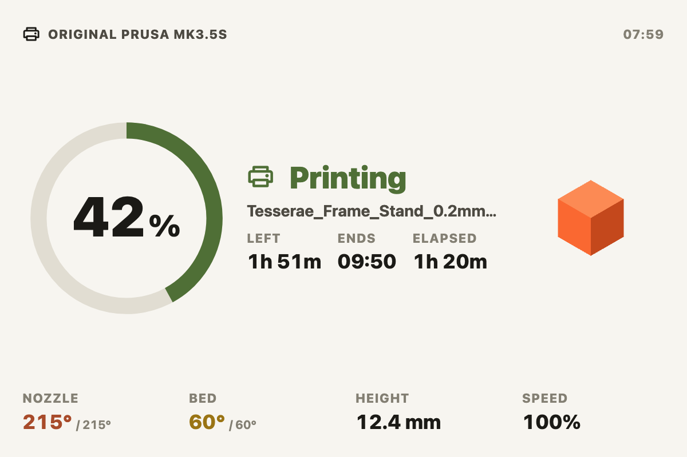
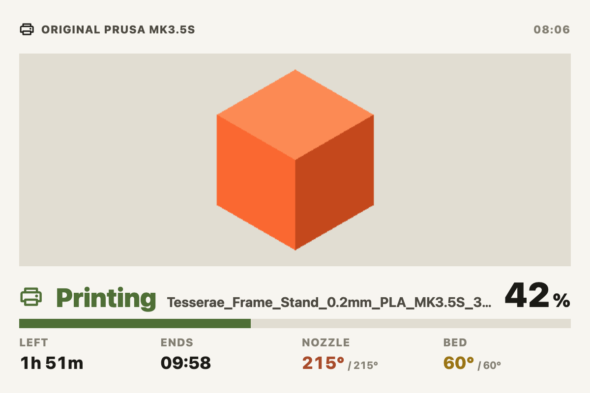

# PrusaLink widget for Tesserae

Print status for an Original Prusa printer on an e-ink panel: what the printer
is doing, how far the print has got, when it will finish, and the nozzle and
bed temperatures.

It reads the printer's own PrusaLink API over your local network. No Prusa
account or Prusa Connect is involved.



> **Status: built and tested against a mock printer only.** It has not yet
> been run against a physical printer. The mock follows Prusa's published API
> document, so the widget should work on PrusaLink firmware, but treat the
> first real connection as a test.

## Folders shipped

- `prusalink_status`

## Setting it up

1. On the printer, open **Settings, Network** and note its IP address.
2. Open **Settings, Network, PrusaLink** and note the password.
3. In Tesserae, open the widget's settings and enter the address
   (for example `http://192.168.1.50`) and the password.

The username is `maker` unless you changed it on the printer; it is under
"More options" in the widget settings.

Printers with PrusaLink built in include the MK4 family, MK3.5, MINI, XL and
CORE One. An MK3 or MK2.5 needs the Raspberry Pi version of PrusaLink, which
serves the same API.

## What it shows

| Printer state | Card |
|---|---|
| Printing | Progress ring, file name, time left, finish time, elapsed |
| Paused, needs attention | Progress ring, time left, elapsed |
| Finished, stopped | Progress ring, elapsed |
| Idle, ready, busy, error | State and a one-line hint |
| Switched off or unreachable | "Offline" (not an error: printers get turned off) |

Nozzle and bed temperatures sit underneath, with the target while heating.
The largest size adds Z height and print speed.

The two larger sizes also show the model preview: the picture your slicer
saves inside the file. The widget downloads it from the printer once per
file. Files sliced without a PNG preview show no picture, and the option
"Show the model preview" turns it off.

### Leading with the model

Set the cell option **Lead with** to **Model preview** and the picture
becomes the hero: it fills the card, with the state, percentage and a
progress bar underneath. The largest size keeps time left, finish time and
temperatures in a row below the bar.



When nothing is printing, or the file has no picture, the card falls back to
the standard layout.

The widget shows an error only for things you need to fix: no address, no
password, or a password the printer refuses.

## Developing against the mock printer

`mock/prusalink_mock.py` is a stand-in printer, standard library only:

```sh
python3 mock/prusalink_mock.py --scenario printing --live
```

It listens on `http://127.0.0.1:8017` with the password `mock`. Point the
widget's settings at that and it renders as if a printer were there.

Change what the printer is doing while it runs:

```sh
curl -X POST http://127.0.0.1:8017/_mock/scenario/paused
```

Scenarios: `idle`, `ready`, `busy`, `printing`, `paused`, `attention`,
`finished`, `stopped`, `error`. Stop the mock to see the offline card.

Useful flags: `--progress 80`, `--duration 3600`, `--no-thumbnail`, `--auth digest` or
`--auth apikey` to allow one sign-in method only, `--digest-algorithm SHA-256`.

The mock's field names and types follow
[Prusa's OpenAPI document](https://github.com/prusa3d/Prusa-Link-Web/blob/master/spec/openapi.yaml).
Its values are invented, and its model preview is a plain orange block.

## Tests

```sh
python -m pytest -q
```

The data tests run on their own. The render tests need a Tesserae checkout:
set `TESSERAE_REPO=/path/to/tesserae`, or keep this repository at
`../widgets/<this repo>` beside it. Without one they are skipped. Run them
with the Tesserae checkout's Python so its dependencies are available.

## License

AGPL-3.0-or-later. See [LICENSE](LICENSE).
